# OM 522 Option 3: Planning delivery routes

**Team:** Sadie Crawford, Zacc Gleason, Annabelle Kemp (OM 522, Fall 2026)

<p>
  
  
  
  
  
</p>

> ### [▶ Explore the interactive site](https://smcrawford6.github.io/om522-option3-delivery-routes/)
> Pick the **small, medium, or large** case (or the hand-checkable and edge cases), switch between the
> rule to beat and our method or show them side by side, hover any stop or truck for its times, and
> click a truck to follow just that driver.

| **38.8%** | **25 → 20** | **0** | **All** |
| :---: | :---: | :---: | :---: |
| less driving on the 120-customer day | trucks needed on that day | routes in our plans that cross themselves | plans pass the independent checker |

**Contents:** [At a glance](#at-a-glance) · [Explore each case](#explore-each-case) ·
[How it works](#how-it-works) · [Quick start](#quick-start) · [Method 1](#method-1-the-rule-to-beat-nearest-feasible-neighbor) ·
[Method 2](#method-2-the-researched-method-solomon-i1--local-search--ruin-and-recreate) ·
[Comparison](#deterministic-comparison-resultscomparisonmd) · [Stress test](#stress-test-of-the-fixed-plans-resultsstress) ·
[Recommendation](#recommendation)

We built this tool for the dispatcher at a single-depot delivery company. Every morning, before anyone
leaves the yard, the dispatcher has to decide which truck takes which customers and in what order each
driver should visit them. The dispatcher runs one command on that day's files and gets back a timed route
for every truck that's needed, along with how much driving, waiting, and service time the plan involves.
We added one assumption that the brief doesn't ask for: a truck's route can't cross over itself on the
map, because we don't think a driver should ever have to double back across their own path. Two
different trucks' routes are still allowed to cross. Our researched method treats this as a hard rule.
The rule to beat is kept exactly as the brief describes it, and its crossings are only reported.

## At a glance

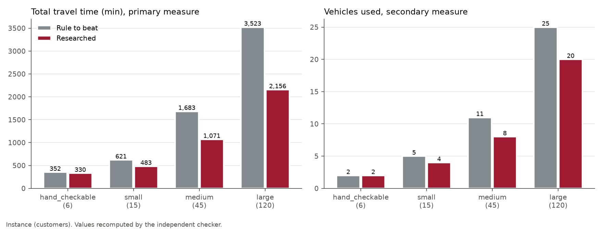

Where the saving comes from: total travel after each stage of the researched method, against the rule to beat.

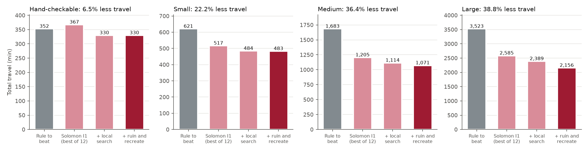

## Explore each case

Click a case to expand it. The [interactive site](https://smcrawford6.github.io/om522-option3-delivery-routes/) shows the same plans with hover details.

<details>
<summary><b>Hand-checkable</b>: 6 customers. Travel 352.4 → <b>329.7 min (6.5% less)</b>, trucks 2 → <b>2</b></summary>

| | Rule to beat | Researched |
| --- | ---: | ---: |
| Total travel (min) | 352.417 | **329.670** |
| Trucks used | 2 | **2** |
| Waiting (min) | 232.9 | 328.8 |
| Self-crossings | 0 | **0** |
| Checker | feasible | feasible |

**Both plans on the map** (gray = rule to beat, crimson = researched, dashed black = a route that crosses itself):

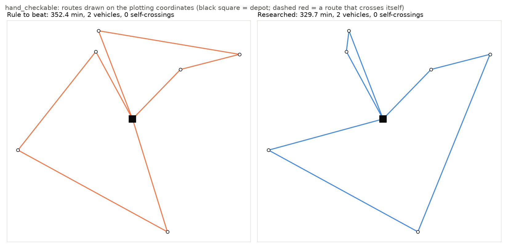

**Each truck of the researched plan**, stops numbered in visiting order:

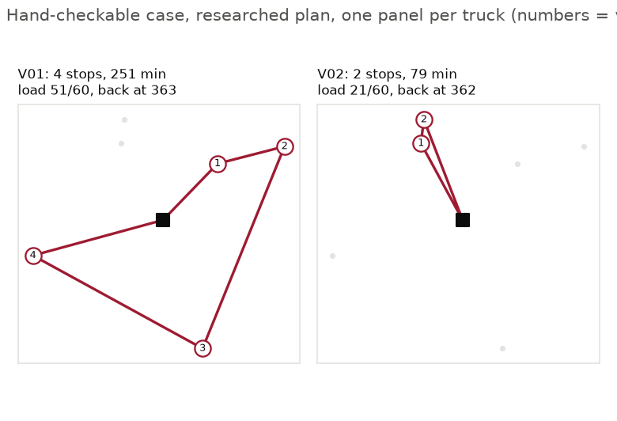

**Each truck's day**: driving, service, waiting, and the customers' time windows:

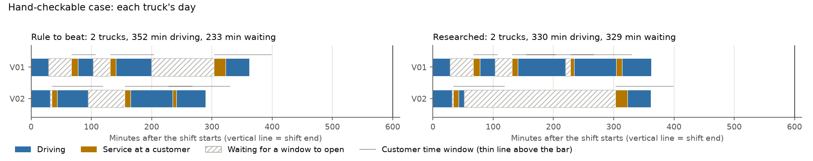

[Open this case on the interactive site](https://smcrawford6.github.io/om522-option3-delivery-routes/#case=hand&plan=compare)

</details>

<details>
<summary><b>Small</b>: 15 customers. Travel 620.6 → <b>483.0 min (22.2% less)</b>, trucks 5 → <b>4</b></summary>

| | Rule to beat | Researched |
| --- | ---: | ---: |
| Total travel (min) | 620.581 | **483.044** |
| Trucks used | 5 | **4** |
| Waiting (min) | 845.8 | 701.2 |
| Self-crossings | 1 | **0** |
| Checker | feasible | feasible |

**Both plans on the map** (gray = rule to beat, crimson = researched, dashed black = a route that crosses itself):

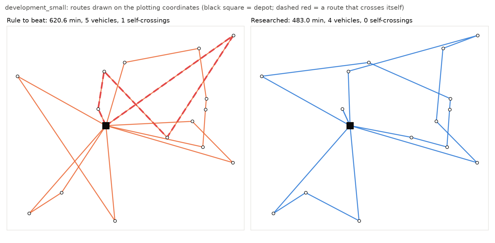

**Each truck of the researched plan**, stops numbered in visiting order:

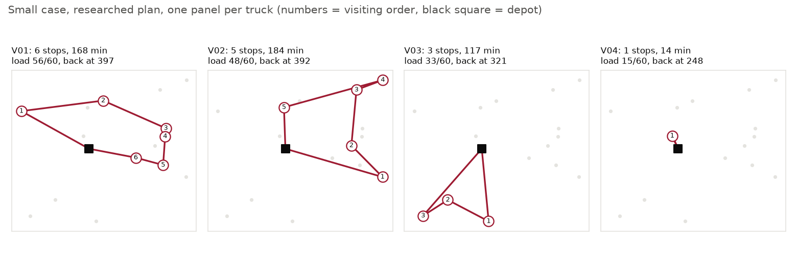

**Each truck's day**: driving, service, waiting, and the customers' time windows:

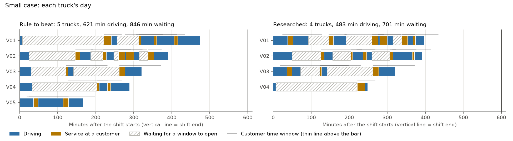

[Open this case on the interactive site](https://smcrawford6.github.io/om522-option3-delivery-routes/#case=small&plan=compare)

</details>

<details open>
<summary><b>Medium</b>: 45 customers. Travel 1,683.4 → <b>1,071.2 min (36.4% less)</b>, trucks 11 → <b>8</b></summary>

| | Rule to beat | Researched |
| --- | ---: | ---: |
| Total travel (min) | 1,683.397 | **1,071.159** |
| Trucks used | 11 | **8** |
| Waiting (min) | 2,199.1 | 2,174.7 |
| Self-crossings | 0 | **0** |
| Checker | feasible | feasible |

**Both plans on the map** (gray = rule to beat, crimson = researched, dashed black = a route that crosses itself):

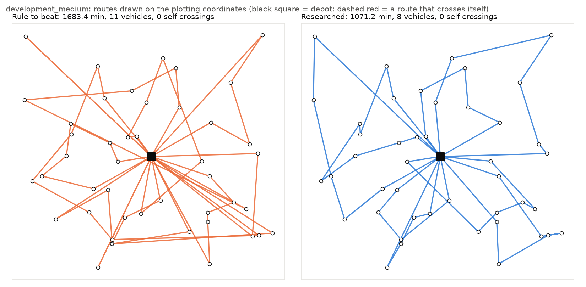

**Each truck of the researched plan**, stops numbered in visiting order:

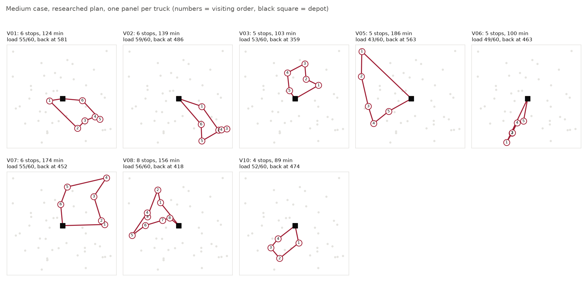

**Each truck's day**: driving, service, waiting, and the customers' time windows:

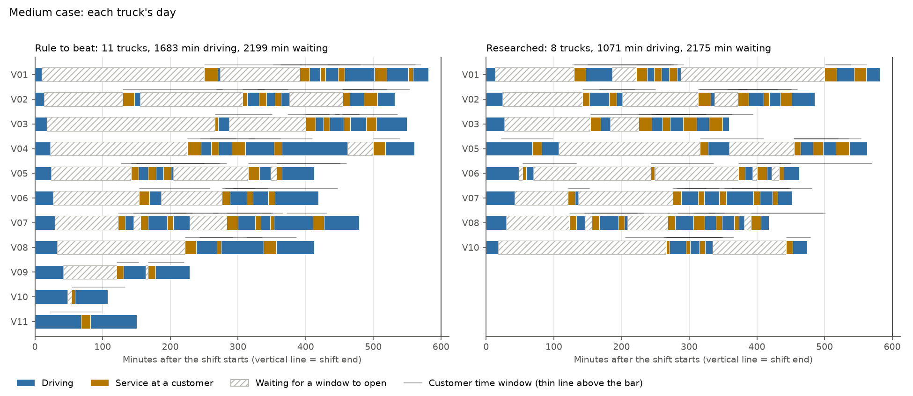

[Open this case on the interactive site](https://smcrawford6.github.io/om522-option3-delivery-routes/#case=medium&plan=compare)

</details>

<details>
<summary><b>Large</b>: 120 customers. Travel 3,523.2 → <b>2,155.9 min (38.8% less)</b>, trucks 25 → <b>20</b></summary>

| | Rule to beat | Researched |
| --- | ---: | ---: |
| Total travel (min) | 3,523.223 | **2,155.902** |
| Trucks used | 25 | **20** |
| Waiting (min) | 5,831.6 | 5,309.2 |
| Self-crossings | 8 | **0** |
| Checker | feasible | feasible |

**Both plans on the map** (gray = rule to beat, crimson = researched, dashed black = a route that crosses itself):

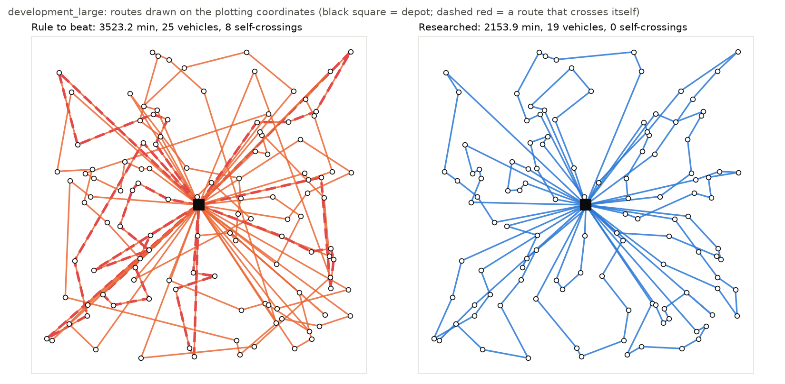

**Each truck of the researched plan**, stops numbered in visiting order:

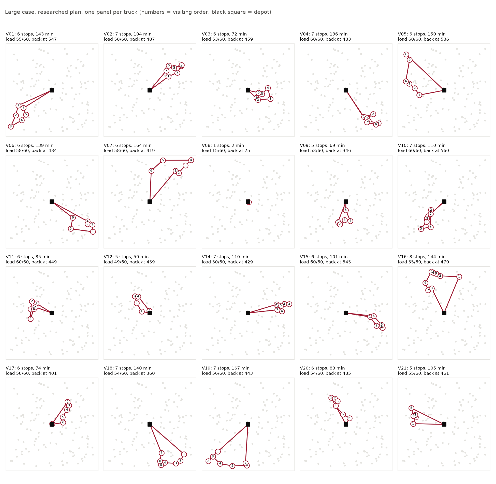

**Each truck's day**: driving, service, waiting, and the customers' time windows:

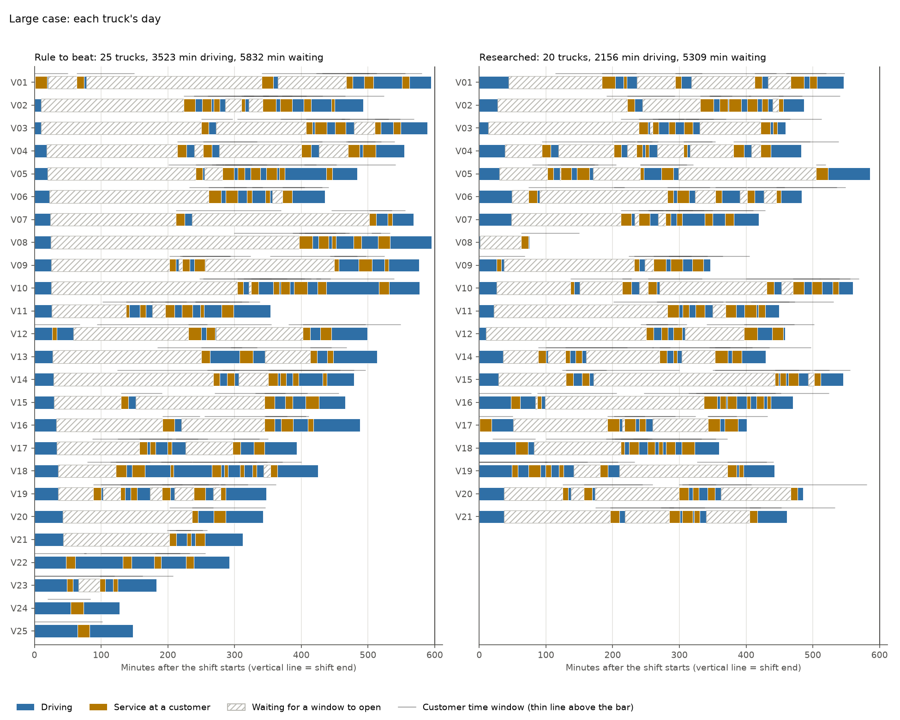

[Open this case on the interactive site](https://smcrawford6.github.io/om522-option3-delivery-routes/#case=large&plan=compare)

</details>

<details>
<summary><b>Edge case</b>: 10 customers. No feasible plan exists, and both methods say so</summary>

Customer C010 orders 65 units, but the largest truck carries 60, so no plan can serve every customer.
Both methods print `no feasible decision found`, write no `decision.json`, and exit with status 0.

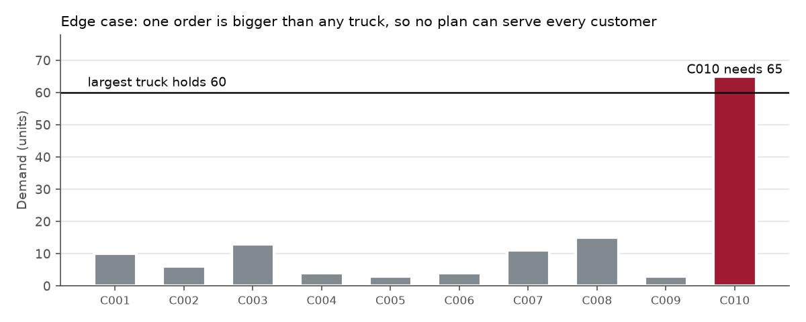

[Open the edge case on the interactive site](https://smcrawford6.github.io/om522-option3-delivery-routes/#case=edge&plan=compare)

</details>

## How it works

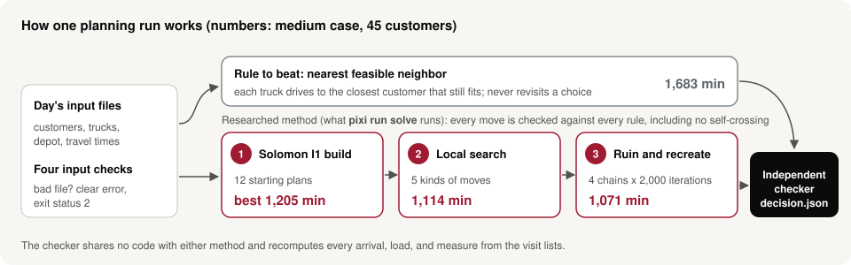

## Quick start

Everything runs through [Pixi](https://pixi.sh):

```bash
pixi install                                        # build the environment from pixi.toml / pixi.lock
pixi run solve <input_dir> <output_dir>             # THE GRADED COMMAND: researched method, default settings
pixi run rule  <input_dir> <output_dir>             # the rule to beat, same input/output contract
pixi run check <input_dir> <output_dir>/decision.json   # independent checker
pixi run test                                       # the automated tests
pixi run reproduce                                  # regenerates every submitted table, figure, and the deck
pixi run presentation                               # rebuilds only presentation/ from results/
pixi run site                                       # rebuilds the README figures and the website in docs/
pixi run demo                                       # live-demo notebook in marimo (separate "demo" environment)
```

`solve` reads any instance directory in the published format and writes `decision.json` (the structure of
`worked-example/solution.json`) plus `summary.md` / `summary.json` (measures, checker result, run status,
seed, stopping rule, and computation time) to the output directory. It never changes the input files.

| Input | What the tool does | Exit status |
| --- | --- | --- |
| Fails one of the four input checks | prints `input error: <file>, column '<column>': ...`, writes no `decision.json` | 2 |
| Valid, but the method finds nothing feasible | prints `no feasible decision found`, writes no `decision.json` | 0 |
| Any other valid input | writes `decision.json` and the summary | 0 |

Options for `solve`: `--method rule|researched` (default `researched`), `--seed` (522), `--chains` (4),
`--iterations` per chain (2000), `--time-limit` safety cap in seconds (300), `--verbose`.

## Repository layout

| Path | Contents |
| --- | --- |
| `vrptw/loader.py` | Reads an instance directory and applies the four input checks (files and columns present, declared types and no empty values, every referenced identifier exists, positive service times), plus sign and interval checks. Nothing is silently replaced. |
| `vrptw/core.py` | Integer-indexed copy of the instance used by both methods, route timing, and the self-crossing test. |
| `vrptw/rule.py` | Method 1, the rule to beat. |
| `vrptw/researched.py` | Method 2, the researched method. |
| `vrptw/checker.py` | Independent checker. Shares no code with either method. |
| `vrptw/cli.py`, `vrptw/experiments.py` | Commands, deterministic comparison, stress test, and figures. |
| `tests/test_tool.py` | 21 tests: the three required ones plus loader, checker, crossing, reproducibility, row-order, and 60-customer held-out-sized tests. |
| `results/` | Submitted decisions, comparison tables, figures, saved stress scenarios, and stress results. |
| `vrptw/visuals.py` | README figures and the website data (`pixi run site`), and the convergence traces (`pixi run traces`). Reads the saved results only. |
| `demo/live_demo.py` | Live-demo marimo notebook: pick a case and method, run it, see the checker's results, map, plan, and code. Runs in its own Pixi environment (`pixi run demo`); the graded commands never use it. |
| `docs/` | The interactive project website (GitHub Pages): `index.html`, generated `data/cases.js`, and the figures in `docs/img/`. |
| `presentation/` | Final-video slide deck (`slides.html`, arrow keys) and speaker script (`script.html`), built by `build.py` from `results/` and the code. |
| `hand_checkable/`, `development_*/`, `edge_case/`, `worked-example/`, `DATA_DICTIONARY.md`, `DATA_README.md` | The instructor's data package, unchanged. |

## Method 1: the rule to beat (nearest feasible neighbor)

Implemented exactly as the option brief states. Vehicles are taken in identifier order, and each one
leaves the depot at its shift start. It repeatedly drives to the nearest unserved customer by travel time
from its current location, with ties going to the smaller customer identifier. That customer must fit
the remaining capacity, allow service to start by its window end, and still allow a return to the depot
by the shift end. When no customer qualifies, the vehicle returns and the next one starts. If any customer
is still unserved after every vehicle has returned, the rule reports "no feasible decision found".

- **Representation:** a list of customers per vehicle, in visiting order.
- **Stopping rule:** every vehicle has returned (or every customer is served).
- **Randomization:** none.
- **Details:** "identifier order" is string order of the identifiers (the class convention; the supplied
  IDs are zero-padded, so it equals numeric order). Window and shift ends are met within the shared
  1e-9 min tolerance in `core.py`, well inside the instructor's 1e-8.
- **Limitations:** the rule is greedy and myopic. It never revisits a choice, so it often drives far to
  catch a closing window and leaves stragglers for extra vehicles. It also ignores the team's
  no-self-crossing rule (7 of its routes cross themselves on `development_large`, 8 crossings in all).
- **Test:** it reproduces `worked-example/` exactly: every visit, arrival, service start, and return
  time, plus total travel 352.417 min, 2 vehicles, and 232.861 min of waiting.

## Method 2: the researched method (Solomon I1 + local search + ruin and recreate)

**Source.** Solomon, M. M. (1987). Algorithms for the vehicle routing and scheduling problems with time
window constraints. *Operations Research*, 35(2), 254–265. This is the reading named in the brief and
the source of the I1 insertion heuristic. The improvement moves are the ones the brief lists. Stage 3
follows Shaw (1998, *CP-98*, LNCS 1520) and Ropke & Pisinger (2006, *Transportation Science* 40(4)).
Granular neighbor lists follow Toth & Vigo (2003, *INFORMS Journal on Computing* 15(4)).

**Why it fits.** Time windows are what make this decision hard. I1 builds routes by choosing, at every
step, the customer and position that add the least travel and push later stops back the least. It
checks every window as it inserts. The local search and ruin-and-recreate stages then fix the poor early
choices a greedy construction cannot revisit. Every local-search move and every ruin-and-recreate
result is checked before it is accepted, so the current solution is always feasible.

**Representation.** One list of customer nodes per vehicle (`routes[k]`); the depot at each end is
implicit. For each route the search caches its load, travel, service starts, and *latest feasible
service start* at each position. The latest starts make a time-window check for an insertion O(1).

**Steps.**
1. *Construction (Solomon I1).* For each vehicle in identifier order, seed a route with the unrouted
   customer that is farthest from the depot or has the earliest window end. Then insert the customer with
   the largest c2 = λ·t(depot,u) − c1, where c1 = α1·(added travel, μ = 1) + (1 − α1)·(push-forward of the
   next stop). Use its cheapest feasible position that does not make the route cross itself. When nothing
   fits, start the next vehicle. The grid of 12 starts is α1 ∈ {0, 0.5, 1} × λ ∈ {1, 2} × the 2 seed
   rules.
2. *Local search* (first improvement, repeated until no move improves total travel) over:
   - relocate a run of 1–3 consecutive customers to another route, in either orientation (or-opt);
   - exchange two customers between routes;
   - exchange route tails (2-opt\*);
   - within a route, reverse any segment (2-opt) or move any run of 1–3 customers (or-opt).

   Moves between routes only pair a customer with its 12 nearest neighbors. Each candidate's travel
   change is computed first. Only an improving candidate is then checked for capacity, every window,
   the shift end, and self-crossing, and it is accepted only if all four pass.
3. *Ruin and recreate.* Four independent chains each start from the best stage-2 solution. Each
   iteration removes 4 to 30% of the customers (at most 30) by random, worst-detour, related (Shaw), or
   whole-short-route removal. It reinserts them by regret-2 or greedy insertion, with or without small
   noise, and may open an unused vehicle. Stage 2 then runs on the changed routes. The result is accepted
   by simulated annealing: the start temperature accepts a 0.5% worse result half the time, and it cools
   geometrically to 1% of that. Before acceptance, every route is re-checked for capacity, windows, shift
   end, and self-crossing. Removing a stop shortcuts a route, and the shortcut can cross another leg of
   it; such a candidate is rejected. A removal that would break the rest of its route (possible when the
   travel table breaks the triangle inequality) is not made. The best solution over all chains is
   returned, and it is verified once more before it is written.

No optimization solver is used (so there is no solver status to report), and no routing package is used.

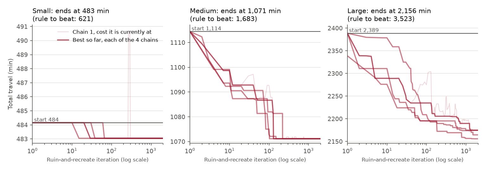

*Stage 3 on each case: the best plan each of the four chains has found so far (log-scale iterations).
Most of the gain comes in the first few hundred iterations.*

**Stopping rule.** 4 chains × 2,000 ruin-and-recreate iterations, a fixed count. The 300-second time
limit is only a safety cap (checked between iterations) and is never reached on the supplied instances
or on our 60-customer test copies. `summary.md` reports which rule stopped the run. A run that hits the
cap would not be reproducible.

**Randomization and seed.** Default seed 522. Chain *c* uses `random.Random(100·seed + c)`, so a rerun
reproduces the decision exactly (tested).

**Fallback.** If no crossing-free I1 start fits the fleet, the method repeats stages 1 and 2 without the
crossing rule. If that also fails, it starts from the rule to beat's plan. `summary.md` then says the
crossing rule was relaxed. It reports "no feasible decision found" only when neither I1 nor the rule can
serve every customer.

**Known limitations.** It is a heuristic with no optimality proof. On the 120-customer instance its four
chains end between 2,155.9 and 2,175.0 min. On `development_medium` the default seed stops at 1,071.159,
and our prototype found a feasible crossing-free plan at 1,070.565. It minimizes travel only, so vehicles used is not
targeted directly (it falls anyway). It plans for exact travel times and builds in no slack. Runtime grows
with size: about 30–40 s at 45 customers, 40–60 s on our 60-customer test copies, and about 85–90 s
at 120 on our laptop.

**The crossing rule and the data.** The data dictionary says coordinates are for maps and plots only.
Our rule is a choice about how a driver's route may look on that map. On every supplied instance travel
time equals straight-line distance (within 0.0005 min), so removing a crossing also shortens the route
when the windows allow it. With time windows the uncrossed order can be infeasible, so the rule can
cost travel; we accept that. If a future data set's travel times were not distances, the rule would
still be enforced, as a driver-facing preference rather than a travel saving.

## Independent checker

`vrptw/checker.py` reads only the instance files and `decision.json`, and it recomputes every arrival,
service start, return time, load, and measure from the visit lists. It uses identifiers and its own
timing and crossing geometry; it imports nothing from either method. It reports each violated
constraint by vehicle or customer: customer missing or served twice, vehicle used twice or unknown,
capacity, window, and shift end. It applies the instructor's 1e-8 tolerance at window and shift ends,
flags reported times that disagree with its own, and counts self-crossings for the team constraint.
Crossings are reported separately and do not make a plan infeasible, because the brief does not
require them. **Crossing definition:** two non-adjacent legs of the same route (the first and last legs,
which share the depot, count as adjacent) cross properly, overlap, or form a T; legs that only meet at
a shared end point (two stops drawn at the same coordinates) do not count. A test confirms that the
method's crossing test and the checker's, written separately, agree on 400 random routes.

## Deterministic comparison (`results/comparison.md`)

Computer: Windows 11 laptop, Intel Core (Family 6 Model 140), Python 3.12 (Pixi). The rule has no time
limit; the researched method uses its defaults above.

| Instance | Customers | Rule travel (min) | Researched travel (min) | Saving | Vehicles rule → researched | Self-crossings rule / researched | Researched time (s) |
| --- | ---: | ---: | ---: | ---: | --- | --- | ---: |
| hand_checkable | 6 | 352.417 | 329.670 | 6.5% | 2 → 2 | 0 / 0 | ~4 |
| development_small | 15 | 620.581 | 483.044 | 22.2% | 5 → 4 | 1 / 0 | ~10 |
| development_medium | 45 | 1683.397 | 1071.159 | 36.4% | 11 → 8 | 0 / 0 | ~30 |
| development_large | 120 | 3523.223 | 2155.902 | 38.8% | 25 → 20 | 8 / 0 | ~85 |
| edge_case | 10 | no feasible decision found | no feasible decision found | | | | <0.1 |

Exact run times are in `results/comparison.md`. Both methods pass the checker on every instance. The
rule runs in milliseconds. The gap widens with
size: on 6 customers the rule's greedy choices cost little, but on 45 and 120 customers they strand
customers that need extra vehicles and long trips. The researched method's waiting time is sometimes
higher (hand_checkable), because it trades waiting, which is free under the brief's measure, for
travel. These results cover four synthetic instances from one generator; they do not show the method
is best in general.

## Stress test of the fixed plans (`results/stress/`)

- **Uncertain input:** travel time. Scenario *s* multiplies every leg by C_s × E_ij. C_s is one
  day-wide congestion factor and E_ij is a factor for each leg; both are independent lognormal draws
  with mean 1, with coefficients of variation 0.15 and 0.10.
- **Scenarios:** 30, from seed 20261103, saved to `results/stress/scenarios/` before either plan is
  executed (`reproduce` generates them first).
- **Execution rule (brief):** follow each planned route of `development_medium` in order and wait when
  early. Every service that starts after its window end and every late return counts as a violation.
  No decision changes.

| Measure (30 scenarios) | Rule to beat | Researched |
| --- | ---: | ---: |
| Mean / 90th percentile total travel (min) | 1639.4 / 1918.6 | 1046.4 / 1241.6 |
| Mean / 90th percentile vehicles used | 11 / 11 | 8 / 8 |
| Scenarios with at least one violation | 6 | 7 |
| Violations in total (late services + late returns) | 12 (6 + 6) | 12 (12 + 0) |
| Minutes late per scenario, mean | 2.1 | 1.7 |

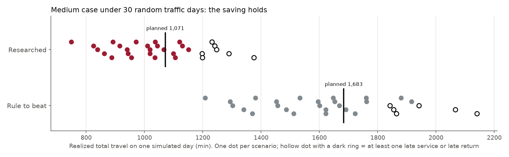

The per-scenario plot (`results/stress/stress_per_scenario.png`) shows realized travel, vehicles used
(constant for a fixed plan), and violations. Mean realized travel is slightly below planned travel for
both plans because these 30 congestion factors average 0.974.

**Sensitivity** (`results/stress/sensitivity.md`): the same saved scenarios rescaled to heavier average
congestion.

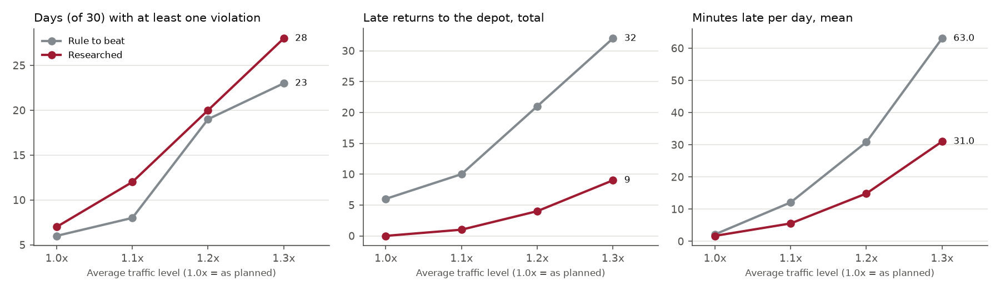

| Mean congestion | Scenarios with a violation (rule / researched) | Violations in total (rule / researched) | Late returns (rule / researched) |
| ---: | --- | --- | --- |
| 1.0 | 6 / 7 | 12 / 12 | 6 / 0 |
| 1.1 | 8 / 12 | 25 / 25 | 10 / 1 |
| 1.2 | 19 / 20 | 61 / 56 | 21 / 4 |
| 1.3 | 23 / 28 | 100 / 96 | 32 / 9 |

## Recommendation

**Adopt the researched method.**

- **Expected benefit:** on the 45-customer development day it cuts planned travel by 612 min (36%) and
  uses 3 fewer vehicles (8 instead of 11). Under the 30 travel-time scenarios it keeps that saving: 593
  min less realized travel on average. It has the same number of violations (12 vs 12), no late returns,
  and fewer minutes late. The evidence comes from one 45-customer day; the held-out case has 60.
- **Tradeoff accepted:** about 30–40 s of computing (about a minute at 60 customers) instead of
  milliseconds. Its routes are also tighter,
  so slightly more days have at least one late service: 7 vs 6 of 30 at planned traffic, and 12 vs 8 at
  +10%.
- **The recommendation would change** if the operation judges a day *only* by whether any window is
  missed (not by minutes late or late returns). Then the rule has fewer bad days at every traffic level
  we tested: 6 vs 7 of 30 at plan, 8 vs 12 at +10%, 19 vs 20 at +20%, and 23 vs 28 at +30%. It pays for
  that with about 590–770 more driving minutes a day. At planned traffic the researched plan trades one
  extra bad day in 30 for about 17,800 fewer driving minutes over those 30 days. So the rule is
  preferred only if avoiding one missed-window day is worth more than that. If zero missed windows is a
  hard requirement, neither fixed plan qualifies even at planned traffic, and the dispatcher should plan
  with buffered travel times or replan during the day.

## Changes since the prototype

The prototype used the same family of researched method: Solomon
I1, then local search, then large neighborhood search. For the final submission we rebuilt the code as
one small plain-Python package in the class's style. We did this so each member can explain it, and
dropped numba and polars. We made four changes:

- The search has four seeded chains and insertion noise, because one chain was sensitive to its seed.
- We added the crossing guard after ruin and recreate: a 60-customer test copy showed that removals
  could leave a route crossing itself.
- The method now falls back if no crossing-free start fits the fleet. A valid instance then always
  gets a decision even when our added rule cannot be met, which the brief does not require.
- The safety cap is now 300 s, so even a slower grading computer finishes well inside the 10-minute
  limit, including loading and writing.

The rule to beat is unchanged.

## Tools used

Claude Code (Anthropic), an agentic coding tool, researched the method and drafted the code, tests,
README, and presentation; the team reviewed every component. We used Python 3.12, matplotlib, pytest,
and Pixi. No code from the in-class notebooks was reused (the method follows the class's convention of
an implicit depot at each end of a route). No paid service, private account, or external system is
needed to run or grade the tool.
